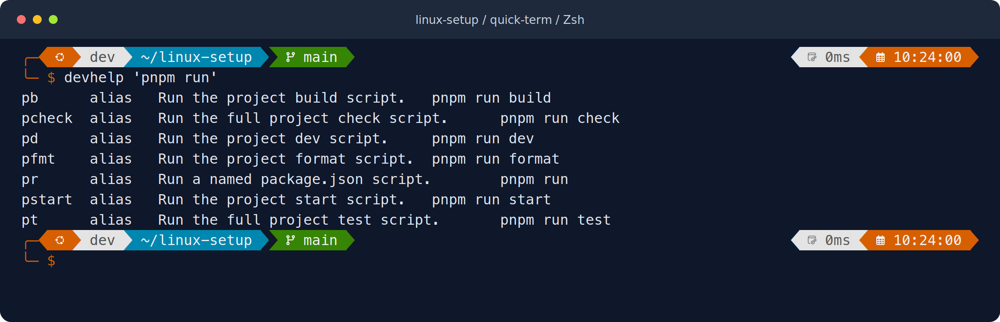
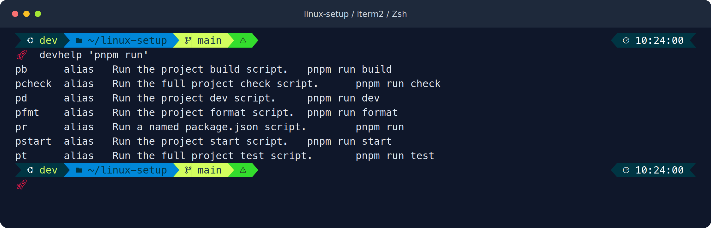
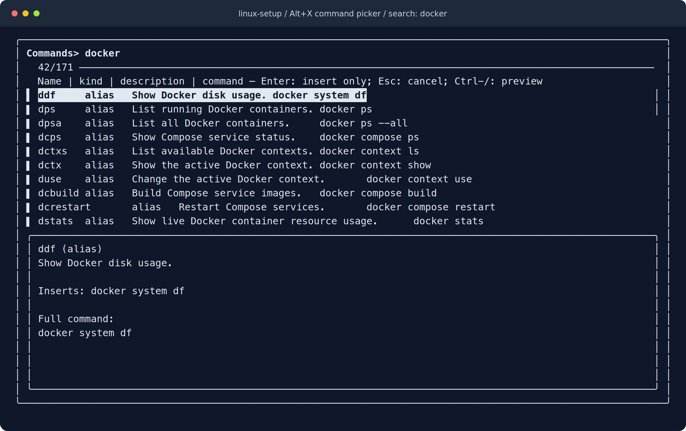

# linux-setup

**A portable Linux terminal setup for everyday development.**

Zsh dotfiles, Oh My Posh themes, an fzf command picker, tmux, and a curated set of
command-line tools—installed in your home directory, with backups and selective
uninstall. Built for Ubuntu, Debian, and their WSL environments.

[](https://github.com/zdevzone/linux-setup/actions/workflows/test.yml)
[](docs/installation.md#supported-systems)
[](config/zsh/)

[Get started](#get-started) · [What's included](#included-tools) · [Command picker](#find-your-commands) · [Documentation](docs/README.md)

## Terminal previews

### Quick-term · default

A two-line prompt with orange accents, directory and Git context, execution time,
and a compact transient prompt that keeps previous commands readable.



### iTerm2 · alternative

A blue and lime prompt with Git state, exit-status color, and a rocket prompt.
The theme's name comes from upstream; it runs in your Linux terminal.



These are rendered samples using the bundled themes, synthetic prompt context,
and real command-reference output. Appearance depends on your terminal and font.
[Switch themes](docs/customization.md#switch-the-prompt-theme) · [Preview gallery and image sources](docs/previews.md)

## Why use it?

- **Carry your setup between machines.** Shared configuration stays in this Git
  checkout; private device settings stay in your home directory.
- **Find commands as you work.** Alt+X searches aliases, functions, descriptions,
  and full commands, then inserts your selection for review.
- **Start with useful tools.** Search files, navigate projects, review Git changes,
  manage terminal sessions, and work with JavaScript and Python environments.
- **Keep installation inspectable.** Preflight checks, dry runs, verified downloads,
  tracked ownership, and backups explain what the setup changes.
- **Remove only what you choose.** Uninstall can restore configuration while
  retaining programs, or remove selected setup-owned tools and caches.

## Get started

You need Linux, Bash, Python 3.9+, working HTTPS certificate trust, and Git to
clone the repository. Ubuntu/Debian also need APT tools and populated package
indexes. See [prerequisites](docs/installation.md#before-starting) for fresh devices.

```sh
git clone https://github.com/zdevzone/linux-setup.git ~/linux-setup
cd ~/linux-setup
./install.sh --preflight
./install.sh --dry-run
./install.sh
export PATH="$HOME/.local/bin:$PATH"
exec zsh
```

In the new shell, run `linux-doctor` to check the installation. Keep the checkout
in a persistent location: live configuration links to these files.

Missing Zsh and other base tools are installed automatically on Ubuntu/Debian
without sudo. Existing base programs, Vite+, and uv are reused. If bootstrap
prerequisites are missing, `./install.sh --install-prerequisites` offers the
administrative package installation and index refresh before continuing.

Choose a **Nerd Font** in your terminal settings to display prompt icons. In WSL
or SSH, configure the font on the desktop client. Installation leaves your
account's login shell unchanged; see [default-shell setup](docs/installation.md#default-shell).
The installer also registers the Oh My Posh MCP server when Codex is present and
that registration is missing; pass `--skip-mcp` to skip it.

### Platform support

| Platform | Status |
| --- | --- |
| Ubuntu/Debian, x86_64 | Primary target; development tested on Ubuntu 26.04, lifecycle CI configured on Ubuntu 24.04 |
| Ubuntu/Debian, ARM64 | Release mappings included; equivalent hardware validation still pending |
| Ubuntu/Debian in WSL | Uses the Linux installation path; fonts belong on the Windows client |
| Other glibc Linux distributions | Install base packages with your package manager first; not yet integration-tested |
| Native Windows, macOS, musl Linux | Outside the current supported targets |

[Full installation guide](docs/installation.md) · [Migrating an existing setup](docs/installation.md#migrating-from-dev-setup)

## Included tools

| Area | Included |
| --- | --- |
| Shell and prompt | Zsh, Oh My Posh, two bundled themes, autosuggestions, syntax highlighting, completion, persistent history |
| Search and navigation | fzf, fd, ripgrep, zoxide, custom command picker |
| Files and previews | eza, bat, Yazi, jq |
| Git and sessions | lazygit, delta, tmux, project session helper |
| JavaScript and Python | Vite+ (`vp`), uv, uvx; existing installations are preserved |
| Local development | TCP listener/port helpers, localhost HTTP server, project readiness checks, Playwright workflow helper |
| PostgreSQL | `psql` client, connection discovery, interactive database/schema manager |
| Setup maintenance | `linux-doctor`, preflight and dry-run checks, verified tool downloads, backup and uninstall workflows |

[`tools.lock.json`](tools.lock.json) pins release artifacts and plugin commits;
base packages follow the host distribution. Project runtimes and dependencies
remain controlled by each project's configuration and lockfiles.

The command library also includes shortcuts for pnpm, Cargo, Laravel, Docker,
GitHub CLI, Kubernetes, Terraform, Codex, and Claude Code. **Those shortcuts do
not install their target tools.** The PostgreSQL setup installs a client, not a
server. [Complete tool reference](docs/tools.md) · [Developer command groups](docs/developer-workflow.md#discover-and-use-custom-commands)

## Find your commands

Press **Alt+X** to search by shortcut, description, or full command. The preview
shows the complete alias expansion or function definition. Enter places the
selection in your editable prompt; it does not run it. Escape or Ctrl+C keeps
your original line.



```sh
devcommands docker   # Open the picker with a search
devhelp pnpm         # Print matching commands without opening fzf
```

Aliases insert their expanded command; functions insert their name so you can
supply arguments. If your terminal intercepts Alt+X, use Escape then x, or type
`devcommands`. New described aliases/functions appear after `reload`.

### Shortcuts to try first

| Command / key | Action |
| --- | --- |
| Ctrl+R / Ctrl+T / Alt+C | Search history / choose files / choose a directory |
| `ll`, `lt`, `ccat FILE` | Detailed listing, shallow tree, highlighted file contents |
| `z NAME`, `y`, `lg` | Jump by directory history, open Yazi, open lazygit |
| `work [DIR]` | Open a named tmux session for a project |
| `lip`, `kip PORT` | Inspect TCP listeners; confirm before stopping a port's processes |
| `dev-check`, `dev-browser doctor` | Check project readiness and browser-test prerequisites |
| `db --connections`, `db` | Inspect PostgreSQL connection targets; open the database manager |

[All terminal shortcuts](docs/terminal.md) · [Developer workflows](docs/developer-workflow.md) · [Database guide](docs/databases.md)

## Make it yours

Shared aliases live in [`config/zsh/aliases.zsh`](config/zsh/aliases.zsh), functions
in [`config/zsh/functions.zsh`](config/zsh/functions.zsh), and themes in
[`config/oh-my-posh/`](config/oh-my-posh/). Add a description comment immediately
above a command definition so the picker can explain it. Run `reload` afterward.

Device-specific settings belong in `~/.config/linux-setup-local/zshrc` and
`zshenv`. Keep credentials, Git identity, SSH keys, and project environment files
outside this repository. [Customization guide](docs/customization.md)

## Update or uninstall

From your installation checkout:

```sh
git pull --ff-only
./install.sh                  # Refresh config and pinned tools
```

Use `./install.sh --config-only --skip-mcp` for configuration changes without tool
downloads. Existing Vite+ and uv versions are preserved; update those managers
through their own supported upgrade workflows.

```sh
./uninstall.sh --keep-tools --dry-run   # Preview configuration restoration
./uninstall.sh --keep-tools             # Restore config; retain installed tools
./uninstall.sh                         # Choose programs and caches interactively
```

Programs and caches are kept unless selected. The uninstaller preserves external
installations and changed files, and checks whether managed Zsh is still your
login shell. [Uninstall and recovery guide](docs/uninstall.md)

## Documentation and contributions

Browse the [documentation index](docs/README.md) for installation, terminal
commands, themes, database management, troubleshooting, and maintenance.

For changes, start with the [development guide](docs/development.md). Local checks:

```sh
bash -n install.sh uninstall.sh
python3 -m unittest discover -s tests -v
```

Report reproducible issues through [GitHub Issues](https://github.com/zdevzone/linux-setup/issues).
Include your distribution, architecture, and redacted error output.

The bundled themes are customized from Oh My Posh. Downloaded tools retain their
upstream licenses; see [project acknowledgements and notices](NOTICE.md).
